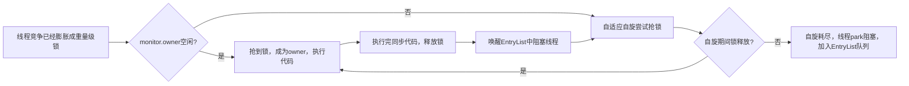

---

title: JVM

published: 2026-08-23

description:  JVM

tags: [ JVM]

category:  JVM

draft: false

---

# JVM

## 简介

- 什么是JVM

  Java Vitual Machine - Java二进制字节码的运行环境

  - 好处

    - 一次编写，到处运行
    - 自动内存管理，垃圾回收功能
    - 数组下标越界检查
    - 多态 — JVM中使用虚方法表

  - 与JRE、JDK的比较

    JRE：在JVM的基础上加上一些基础类库

    JDK：JVM+基础类库+编译工具

    


- 常见的JVM

  JVM本身是一套规范，只要根据这套规范来就可以实现出自身的JVM。如Oracle的HotSpot、Eclipse的OpenJ等


- JVM结构

  

---

## JVM内存结构

### 1.程序计数器

- Program Counter Register（程序寄存器）工作过程

  

  1. Java源代码转换为**字节码文件**后，在字节码文件中存储的都是**JVM指令**。
  
  2. JVM指令需要由**解释器**解释为**机器码**，再交由CPU执行
  
  3. 每条**JVM指令**都有着对应的**地址**，而程序计数器就是用来**存储下一条JVM指令执行地址的**
  
     如上图：刚开始程序计数器内记录的地址为0，在`getstatic`指令执行后记录的地址就变为了3，指向`astore_1`。
  
  > 在程序运行的过程中，读取JVM指令地址的操作非常频繁，所以**使用CPU中的寄存器来实现程序计数器**，所以其又名程序寄存器


- 特点

  - 线程私有

    Java中允许多线程运行，在多线程并行时，CPU中的**调度器**组件会为不同线程**分配时间片**

    - 如：现有两个线程，线程1、2。调度器先为线程1分配时间片，线程1开始执行，等到时间到了后，会**暂存线程1的状态**，并**为线程2分配时间片。**

    基于上述描述，当时间片耗尽后会暂存线程状态  — 通过**程序计数器**记录下一跳指令的地址实现暂存。

    而由于不同线程所对应的指令地址不同，所以**每一个线程都会有一个程序计数器**

   

  - 不会存在内存溢出

    堆、栈、方法区部分都会存在内存溢出，但是程序计数器是JVM内存结构中唯一不会出现该问题的部分

    - 原因

      程序计数器始终只存储一条指令的地址，**不会产生内存的增长**

---

### 2.虚拟机栈

- 简介

  - **线程**运行时**所需的内存空间**，每一个线程都有自己**独立的栈空间**

  

  - 虚拟机栈由**栈帧**组成，一个**栈帧**就代表着一次**方法**的调用

    - 栈帧：一个方法运行时需要的内存。包括：**方法参数、方法内的局部变量、方法的返回地址**所需的内存
    - 方法返回地址：记录着方法被调用的地址。如：方法A调用方法B，在方法B结束后会**返回方法A是在哪调用的方法B**，如此一来，方法B结束后方法A**可以根据这个地址继续执行**

    方法开始执行时，将栈帧压入栈内；方法执行结束后，将栈帧弹出。

    Tip：当方法A调用方法B时，方法B的栈帧会被压入栈，并执行完方法B，弹出方法B的栈帧后。才会继续执行方法A

   

  - 每个线程只能有一个**活动栈帧**，对应着正在执行的那个方法（即：同时最多只能有一个方法在执行）


- 问题辨析

  - 垃圾回收是否会设计栈内存？

    **不会**。栈内存由一个个栈帧内存组成，在方法执行完后栈帧会被弹出并被自动处理。垃圾回收回收的是堆内存

    

  - 栈内存的分配越大越好吗？

    **不是**。由于每个线程都有一个栈，所以在物理内存一定的前提下，**栈内存越大**，**线程数越少**。而栈内存**过小**的话又可能会导致程序无法正常运行**（栈溢出）**

    

  - 方法内的局部变量是否线程安全？

    如果方法内的局部变量没有逃离方法的作用范围，那么就是线程安全的。否则可能会有线程安全问题

    ```java
    public static void m1() {
        StringBuilder sb = new StringBuilder();
        sb.append(1);
        sb.append(2);
        sb.append(3);
        System.out.println(sb.toString());
    }
    
    public static void m2(StringBuilder sb) {
        sb.append(1);
        sb.append(2);
        sb.append(3);
        System.out.println(sb.toString());
    }
    
    public static StringBuilder m3() {
        StringBuilder sb = new StringBuilder();
        sb.append(1);
        sb.append(2);
        sb.append(3);
        return sb;
    }
    ```

    上面的代码块中，只有m1是线程安全的。m2的StringBuilder写在**形参中**，可能被其他线程访问到；m3的StringBuilder被**返回了**，可能被其他线程访问到

    - **原因**
      1. StringBuilder本身是线程不安全的
      2. StringBuilder为**引用型对象**，对象**存储在堆当中**，栈中存储的是对象的地址。若地址可以被其他线程所访问到，就可能会引发线程安全问题

    

    而对于**静态变量**，其不存在栈帧当中，而是存储于静态区，所以多个线程是共享静态变量的。所以**静态变量会存在线程安全问题**


- 栈溢出

  - 栈帧过多导致栈内存溢出（死递归）

  - 栈帧过大导致栈内存溢出

    这在**Java中并不常见**，因为Java中只有基本数据类型存储在栈内，像数组、对象等都存储在堆内。而在**C**中数组是存储在栈中的，若在`main`函数中定义过大的数组就会出现这种情况

---

### 3.本地方法栈

- 本地方法：Native Method。不是由Java编写的代码，Java**对内存的操作有一定的限制**，所以**无法直接与操作系统底层交互。**因此，需要一些由C、C++语言编写的方法与操作系统底层交互。在Java中再去调用这些方法的接口。

  > 在Java中，本地方法通过`native`修饰

  

Java中为本地方法划分了一块栈空间，被称为本地方法栈，用于调用本地方法

---

### 4.堆

- Heap

  通过new关键字创建的对象都会存储到堆内存中


- 特点
  - 堆中的对象是线程共享的，所以需要考虑线程安全问题
  - 堆有垃圾回收机制，自动处理垃圾，防止堆内存溢出


- 堆内存溢出

  当对象一直在使用（无法被视为垃圾回收），并且对象在不断增大、增多。就可能会出现堆内存的溢出

  - 堆内存诊断工具
    - jps：查看当前系统中有哪些java进程
    - jmap：查看某进程堆内存的使用情况
    - jconsole：图形化界面，多功能检测工具，可以持续监测堆内存
    - jvisualvm：图形化界面，可齿距监测堆内存，功能比jconsole更强大

---

### 5.方法区

- 定义

  用于**存储类的信息、类加载器、运行时常量池、StringTable（串池）**，逻辑上属于堆的一部分。但是各个厂商在实现时可以选择不将其归为堆的一部分。

  

  Oracle的JVM在**JDK1.8前**是将其**写在PermGen（永久代）中**的，永久代是虚拟内存中一块**独立于堆的空间。**

  

  在**JDK1.8后**，这一部分就被放入了**MetaSpace（元空间）**中，而MetaSpace是被存储于本地内存中的

  

  > JDK1.7前，串池是常量池的一部分；JDK1.7后，串池被剥离出方法区，归入了堆中


- 内存溢出

  由于永久代是虚拟内存的一部分，而元空间是本地内存的一部分，所以**永久代更容易产生内存的溢出**（创建的类过多，框架中会产生很多类）


- 常量池

  - 二进制字节码文件

    存储了**类的基本信息、常量池、类的方法定义、虚拟机指令**

  **常量池本质上就是一张表**，虚拟机指令可以根据**符号地址（#xxx）**去常量池中**查表**得到要执行的**类名、方法名、参数类型、字面量等信息**

   

  - **运行时常量池**

    常量池是存储在`*.class`二进制字节码文件中的，当该类被加载时，会其**常量池信息**从字节码文件中加载到**运行时常量池**，并**将里面的符号地址（#xxx）变为内存中的真实地址。**如此一来，程序运行时就可以在内存中查询常量了

---

#### 5.1StringTable

- 串池

  **JDK1.7前**，串池放在运行时常量池中；**JDK1.7后**，串池被移除运行时常量池，放入堆中；**JDK1.8后**，永久代被元空间替代，运行时常量池、类的信息、类加载器等被移到了本地内存中

  - 为什么要将串池从永久代的常量池中转移到堆中？

    主要是因为**永久代**（方法区实现）的 **GC 回收效率太低**，只有在整堆收集 **(Full GC)**的时候才会被执行 GC。Java 程序中通常会**有大量的被创建的字符串等待回收**，将字符串常量池放到**堆**中，能够**更高效及时地回收字符串内存**。


- 字符串对象的创建流程1

  ```java
  public class Demo1_22 {
  
      public static void main(String[] args) {
          String s1 = "a";
          String s2 = "b";
          String s3 = "ab";
      }
  }
  ```

  1. 程序启动时，将`.class`字节码文件中的常量池信息加载到运行时常量池中
  2. 在堆中准备好串池StringTable，初始状态为空 `[]`
  3. 执行到`4`时，代表着虚拟机指令中的`ldc 对象地址`，会将**a符号变为字符串对象“a”**。并去串池中寻找有无“a”，若没有，则将“a”放入串池中。此时串池中存储了 `["a"]`
  4. 同理执行到`5`、`6`时，也会**将b和ab变为字符串对象“b”,”ab”**，并去串池中寻找，发现没有，将其存入串池。串池中存储了`["a","b","ab"]`

  > 上述过程中，字符串对象的创建属于**”懒加载“**策略，只有在用到时才去创建。而非程序一启动就创建好


- 字符串对象创建流程2

  ```java
  public class Demo1_22 {
  
      public static void main(String[] args) {
          String s1 = "a";
          String s2 = "b";
          String s3 = "ab";
   		String s4 = s1+s2;
          String s5 = "a" + "b";
      }
  }
  ```

  - `String s4 = s1+s2`底层为`new StringBuilder.append("a").append("b").toString`，所以s4是存储在堆空间中的，而s1、s2、s3都是存储在串池中的（指向串池中的常量字符串）

  - `String s5 = "a"+"b"`，该过程并没有new一个对象出来，而是先将“a” “b”拼接成“ab”，并去串池中寻找，发现串池中有“ab”，则直接**将s5指向串池中的“ab”常量字符串**。  所以`s3==s5`结果应该是`true`

    > 底层为javac在编译期间的优化，不同于s4 = s1+s2，s5=”a“+”b“中”a“，”b“都是已经确定的常量字符串，所以**在编译期间就可以对其进行拼接并确定串池中有没有”ab“这个字符串**。而s1、s2这两个是变量，**无法在编译期间确定下来**，所以底层采用StringBuilder在**运行期间**对其进行拼接


- 字符串对象创建流程3

  ```java
  public class Demo1_22 {
  
      public static void main(String[] args) {
  		String s = new String("a") + new String("b");
      }
  }
  ```

  上述代码中，串池中有`["a","b"]`，而”ab“是由对象拼接而成，故而在堆中

  可以使用`intern`将**字符串对象放入串池**

  ```java
  //尝试将字符串对象放入串池当中，若串池中已有则不放入，若串池中没有则放入。   返回值为串池中的对应字符串
  String res = s.intern();//res指向串池中的"ab"
  ```

  若串池中**没有“ab”**，当执行了`intern`将s放入串池后，**s也会指向串池中的“ab”**

  若串池中**有”ab“**，当执行了`intern`后，s不会被放入串池，也就是说s还是**指向堆中的那个字符串对象**

  > 上面两条规则只适用于JDK1.8后的版本
  >
  > JDK1.6前的版本中，使用`intern`时，若串池中没有“ab”，会**将s复制一份放入串池**，也就是说，不会改变s的指向，**s永远指向堆中的那个字符串对象**


- StringTable性能调优

  - StringTable底层通过Hash表**（链表处理Hash碰撞）**的结构实现。Hash表的性能与其大小密切相关，Hash表越大，发生Hash碰撞的几率越小，查询性能就更高。

    综上，可以通过调整`-XX:StringTableSize=?`实现其性能的一个调优

  - 考虑将字符串对象是否入池

    字符串对象存在堆中时，每个字符串都对应着一个对象。其中可能会有很多重复的字符串，若使用`intern`将这些字符串对象存入串池，那么就可以去重，大大减小所需的存储空间

---

### Extra – 直接内存

- 并不属于JVM的内存范畴，直接内存属于**操作系统内存**
  - 常见于NIO操作时，用于数据缓冲区
  - 分配回收成本高，但读写性能高
  - 不受JVM内存回收管理


- IO流程

  

  1. Java本身并没有磁盘读写能力，需要调用本地方法进行磁盘的读写。调用本地方法时CPU状态就由**用户态 $->$ 内核态**
  2. 切换为**内核态**后，就可以由CPU的函数去**读取磁盘文件到系统缓存区了**
  3. Java没有访问系统缓存区的权限，所以要再将系统缓冲区的内容读取到Java缓冲区。

  > 上述流程中，需要两份缓冲区互相读写，浪费资源且效率不高

  

  加入直接内存后，相当于Java和系统共享一份直接内存用于读写。如此一来IO效率就会高很多

  ```java
  ByteBuffer bb = ByteBuffer.allocateDirect(直接内存大小);//分配直接内存
  ```


- 内存溢出

  直接内存的使用受到本机总内存的限制，若分配不当，可能导致内存溢出

  - 直接内存回收原理

    直接内存无法被GC自动回收，本质上是需要使用`unsafe.freeMemeory`手动回收的。**ByteBuffer的实现类内部**，使用了Cleaner (虚引用) 来**监测ByteBuffer对象**，一旦**ByteBuffer对象被垃圾回收**，那么就会由**ReferenceHandler线程通过Cleaner的clean方法调用freeMemory来释放直接内存**

   

  - 禁用显式垃圾回收对直接内存的影响

    实际开发中，为了防止程序员手动进行`System.gc()`垃圾回收（这种回收方式属于Full GC太耗费性能）， 一般会加上`-XX:DisableExplicitGC`参数来禁用显式垃圾回收

    但是一旦禁用显式垃圾回收，会导致**无法手动释放ByteBuffer对象**，从而导致直接内存无法得到**即使释放**

    - 解决方法

      使用暴力反射得到`unsafe`对象，直接使用`unsafe.freeMemeory`手动释放直接内存


---

## GC

### 1.判断垃圾

> 如何判断一个对象是否可以被回收？

#### 1.1引用计数法

一个对象，每被引用一次就对其计数+1，反之则-1。当引用为0时，说明该对象每被引用，那么该对象就可以被视为垃圾了

- 存在问题

  循环引用的情况下，会出现某些对象无法被回收的情况

  

  如图，A、B对象循环引用，导致A、B的引用计数都为1。就算在程序中没有用到这两个对象，也会导致这两个对象的引用计数无法归零，从而无法被当成垃圾回收

---

#### 1.2可达性分析算法（JVM使用）

- 算法流程

  扫描堆中的对象，扫描过程中，判断对象是否能沿着**GC Root对象**为起点的**引用链**被找到，若找不到，说明可以被回收

 

- GC Root

   GC Root对象不止一个，是一些确定**不会被回收的对象**，包含以下几类

  1. **虚拟机栈（栈帧中的本地变量表）中引用的对象**

     方法里局部变量引用的对象。

  2. **方法区中类静态属性引用的对象**

     `static Object obj;` 静态变量引用的对象

  3. **方法区中常量引用的对象**

     字符串常量池里的引用

  4. **本地方法栈 JNI (Native 方法) 引用的对象**

     native 代码引用到的 Java 对象

 

- 举例

  1. ```java
     public class Demo {
         public static void main(String[] args) {
             // main方法栈帧局部变量，属于GC Roots
             Object a = new Object();
             // a引用指向堆里面新建的对象
             a = null; 
             // 断开引用。现在堆中的Object对象，没有任何GC Roots能到达它
             // 可达性分析判定：不可达 → GC可以回收
         }
     }
     ```

     如上，局部变量a引用了堆中的一个Object对象，所以该Object对象为GC Root对象；当a置为null时，原先的Object就不再是GC Root对象了，就成为不可达的了

  2. ```java
     public class ReferenceChainDemo {
         static class Node {
             Node next;
         }
     
         public static void main(String[] args) {
             Node objA = new Node();
             Node objB = new Node();
             Node objC = new Node();
             Node objD = new Node();
     
             // 手动串起引用链
             objA.next = objB;
             objB.next = objC;
             objC.next = objD;
     
             objA = null;
         }
     }
     ```

     如上，$objA->objB->objC->objD$（此处的objX表示objX指向的对象，而非变量）,其中$objA$为GC Root，根据这条引用链就可以找到其他三个对象。但当`objA=null`时，原先$objA$指向的那个对象就不再是GC Root了，上述所有对象都变为不可达的对象了，所以都会被视为垃圾


- 五种引用

  

  图中绿色的矩阵代表着**软引用对象（SoftReference<>）、弱引用对象(WeakReference<>)、虚引用对象(PhantomReference<>)…..**

  1. 强引用

     我们平时`new`的所有对象默认都是强引用。当某对象被强引用时，不可被GC回收，除非断开引用使其变为不可达，才可被GC回收

  2. 软引用

     ```java
     SoftReference<Object> softRef = new SoftReference<>(new Object());
     // 获取对象
     Object o = softRef.get();
     ```

     如上，需要用`SoftReference<Object>`加以修饰才是软引用。**内存不够的时候会被GC**；内存充足就保留。适合做**缓存**

  3. 弱引用

     ```java
     WeakReference<Object> weakRef = new WeakReference<>(new Object());
     Object o = weakRef.get();
     System.gc();
     // GC执行过后，目标对象大概率被回收，get()返回null
     ```

     如上，需要用`WeakReference<Object>`加以修饰才是弱引用。只要触发GC就**一定会被回收**。弱引用无法熬过一次 GC。只要 GC 线程扫描到，并且没有强引用，直接回收。适合做**临时缓存**

  4. 虚引用

     ```java
     ReferenceQueue<Object> queue = new ReferenceQueue<>();
     PhantomReference<Object> phantomRef = new PhantomReference<>(new Object(),queue);
     ```

     **get () 永远返回 null，拿不到对象**    唯一作用：**当对象被回收时收到一个系统通知**。 **必须**搭配 `ReferenceQueue` 使用。

     如图所示，在[直接内存](#Extra – 直接内存)底层的回收中，是通过虚引用ByteBuffer，当`ByteBuffer = null`即不再强引用ByteBuffer并**被回收后**，会收到一个系统通知（准确来说是**放入队列**，放入队列后再做处理），从而**触发直接内存的释放**。由此可见，虚引用更像一个**监听**的机制

  5. 终结器引用

     由JVM自动创建，创建条件如下。

     1. 对象**没有任何强、软、弱引用可达**（快要死了）

     2. 这个类**重写了 finalize ()**

     3. 这个对象的 `finalize()` **从来没有被执行过**

     终结器引用对象一创建就会放入`ReferenceQueue`，第一次GC时，`Finalizer`线程执行`finalize()`函数，第二次GC时，将对象彻底回收

     > finalize()函数用于释放一些不在JVM虚拟机内的资源

   

  - 引用队列作用

    - 软、弱引用

      软、弱引用需要由`SoftReference<>`、`WeakReference<>`去软引用、弱引用正常对象。当正常对象被GC了后，`SoftReference<>`和`WeakReference<>`仍然被强引用着，无法被GC。**可以将其放入引用队列**，做后续的处理（**释放强引用**）。当然也可以不做处理

       

    - 虚引用

      虚引用的正常对象被释放后，虚引用对象就要被放入引用队列中去，用以触发一些逻辑（如释放直接内存）。以此实现监听效果

       

    - 终结器引用

      终结器引用已经创建就要放入引用队列中去，以便`Finalizer`线程执行`finalize()`函数，当第二遍GC时彻底释放对象

       

---

### 2.垃圾回收算法

#### 2.1标记清除

- 标记

  **扫描堆内存中的各个对象**，对每个对象看有无**GC Root**引用了它，若没有则对其进行标记，后续进行清除

  

- 清除

  实际上是**逻辑上的清除**：将需要清除的对象的起始地址、结束地址记录为空闲地址。下次分配空间时将其分配到空闲空间即可

  - 优点：不用内存的实际清除，操作速度快
  - 缺点：产生了很多内存碎片（空间不连续导致无法充分利用内存），浪费资源，可能导致内存溢出

  


#### 2.2标记整理

- 标记

  同标记清除的第一步


- 整理

  在清除的过程中，将可用的对象向前移动，使得内存更为紧凑，被清除掉的内存就变为了连续的空间。解决了内存碎片的问题

  

  Tip：由于整理过程中涉及到了对象的移动，牵扯到了引用当前对象的变量的值的改变等等，效率会比较低


#### 2.3复制

- 标记

  同上


- 复制

  涉及到两块内存`FROM`和`TO`

  1. 将FROM中不是垃圾的对象复制到TO中，并进行整理

     

  2. 清空FROM

     

  3. 交换FROM和TO

     

  优点：不会产生内存碎片

  缺点：需要占用双倍空间的内存

---

### 3.分代回收

> 上述三种算法在JVM中会根据不同的情况采用不同的垃圾回收算法


#### 3.1JVM中的堆内存划分

- 新生代

  存储的都是一些临时对象，垃圾回收发生的较为频繁

  

  新生代内部还划分了三个区域：伊甸园、幸存区From、幸存区To


- 老年代

  存储的都是长期对象，垃圾回收发生的频率很低，只有在堆内存空间不足时才会触发垃圾回收

---

#### 3.2分代垃圾回收流程

- 流程

  1. 新建一个对象时，对象都会被存入伊甸园

  2. 当**伊甸园**的空间被**占满**时，触发$Minor \ \  GC$， 会在**伊甸园和幸存区From**中扫描，标记哪些对象变为了垃圾

     > Tip：初始状态时幸存区From中没有对象，但是后面就会有对象进入，所以还需扫描幸存区From

  3. 将仍然存活的对象复制到**幸存区To**中，并将幸存对象的**寿命+1（初始寿命为0）**

  4. 清空**伊甸园和幸存区From**，并交换幸存区From和幸存区To

  

  当对象寿命超过一个阈值时（默认为15即4bit），对象就会从新生代**晋升到老年代**

  - 当**老年代的空间不足**时，会先尝试触发$Minor \ \ GC$，若空间仍然不足，会触发$Full \ \ GC$，对**新生代区域和老年代区域**做一个全局的垃圾回收（标记清除或标记整理算法）

  > 补充：触发$Minor \ \ GC$和$Full \ \ GC$时会触发$stop \ the \ world$ ，**暂停其他用户的线程**，让垃圾回收的线程先工作，避免因垃圾回收过程中对象地址的变化导致程序运行出错。  $Full \ \ GC$的$stop \ the \ world $时间更长

  - 若触发$Full \ \ GC$后空间仍然不足，则抛出异常$OutOfMemeoryError$ 


- 特例 — 大对象直接存入老年代

  当创建了一个很大的对象时（超过伊甸园的空间大小），此时就算进行$Minor \ \ GC$也没有用，若老年代中可以存下那么大的对象，会将对象直接存入老年代

---

### 4.GC相关的参数

| 含义               | 参数                                                         |
| ------------------ | ------------------------------------------------------------ |
| 堆初始大小         | -Xms                                                         |
| 堆最大大小         | -Xmx 或 -XX:MaxHeapSize=size                                 |
| 新生代大小         | -Xmn 或 (-XX:NewSize=size + -XX:MaxNewSize=size)             |
| 幸存区比例（动态） | -XX:InitialSurvivorRatio=ratio 和 -XX:+UseAdaptiveSizePolicy |
| 幸存区比例         | -XX:SurvivorRatio=ratio                                      |
| 晋升阈值           | -XX:MaxTenuringThreshold=threshold                           |
| 晋升详情           | -XX:+PrintTenuringDistribution                               |
| GC 详情            | -XX:+PrintGCDetails -verbose:gc                              |
| FullGC 前 MinorGC  | -XX:+ScavengeBeforeFullGC                                    |

> 补充：SurvivorRatio=8 代表 Eden : Survivor0 : Survivor1 = 8 : 1 : 1。


---

### 5.垃圾回收器

#### 5.1串行

- 单线程，适合堆内存较小、CPU核数较小的情况


- 指令：`-XX:+UseSerialGC = Serial + SeriaOld`。其中，$Serial$针对新生代，使用复制算法；$SerialOld$针对老年代，使用标记整理算法 。


- 垃圾回收线程示意图

  

  会在**安全点**开始进行STW，**并开启一个线程用作垃圾回收线程**，执行对应的回收算法

---

#### 5.2吞吐量优先

- 多线程，适合堆内存较大的场景，需要多核CPU支持（线程可以抢夺的时间片数量 = CPU核数）

  - 目标

    尽可能让**单位时间**内，STW（$stop \ the \ world$）的**总时间**最短

    如：单次STW时间为0.2s，但是单位时间内只发生两次，那么总时间就为0.4s。可见，吞吐量优先在意的是单位时间内垃圾回收的次数，次数越少，吞吐量越大


- 指令：`-XX:UserParallelGC`$UserParallelGC$针对新生代，算法为复制；`-XX:UserParallelOldGC`$UserParallelOldGC$针对老年代，算法为标记整理

  - `-XX:+UseAdaptiveSizePolicy` 自适应大小策略。开启后，JVM会**动态监控**Eden、两个Survivor区的**回收情况**、GC**停顿时间以及吞吐量**，并以此为依据**自动调整**Eden与Survivor的**区域比例**和对象晋升到老年代的**年龄阈值**

  

  - `-XX:GCTimeRatio=ratio` 吞吐量目标。

    $(\text{吞吐量}=\frac{\text{应用运行时间}}{\text{应用运行时间}+\text{GC消耗时间}})$    `GCTimeRatio = r` → GC 时间占比目标：$ (\boldsymbol{\dfrac{1}{1+r}})$

    以此计算出单位时间内垃圾回收的总耗时，若实际总耗时达不到这个目标，就会动态增大新生代的大小，来达到目标

    新生代越大 → 每次回收的对象越多 → 吞吐量越大；

  

  - `-XX:MaxGCPauseMillis=ms` GC 最大停顿时间目标。默认值为200ms

    告诉 ParallelGC：**希望每次新生代 GC 的 STW 停顿时间，不要超过 200 毫秒**。为了尽力达成这个目标，JVM 会**自动缩小新生代的大小** 新生代越小 → 每次回收的对象越少 → GC 停顿越短；


- 垃圾回收线程示意图

  

  会在**安全点**开始进行STW，**并开启多个线程用作垃圾回收线程并行进行垃圾回收**，执行对应的回收算法。

  线程数默认情况下与CPU核数相同，所以垃圾回收时CPU使用率为$100\%$  ，可以使用`-XX:ParallelGCThreads = n`调整线程数

---

#### 5.3响应时间优先

- 多线程，适合堆内存较大的场景，需要多核CPU支持（线程可以抢夺的时间片数量 = CPU核数）

  - 目标

    尽可能让回收垃圾过程中的STW（$stop \ the \ world$）的**单次时间**最短


- 指令：`-XX:UserParNewGC`$UserParNewGC$针对新生代，**并行**使用复制算法； `-XX:UseConcMarkSweepGC`$UseConcMarkSweepGC（CMS）$针对老年代，使用标记清除算法。


- $CMS$垃圾回收线程示意图

  

  注意此处是**并发**运行

  - 并发：**多个任务交替使用同一个 CPU**
  - 并行：**多个任务在多个不同 CPU 核心上，真正同时一起执行**。

  1. 第一个安全点后，必须全部停下来，是为了**寻找GC Root**。（耗时短）
  2. 第二个安全点后，即找到了GC Root，开启多线程并发对所有的对象进行标记
  3. 第三个安全点后，全部停下来，**修正**并发期间变动过的少量对象。（耗时短）
  4. 第四个安全点后，既可以并发进行清理

  整个流程中，最耗时的标记和清理两个环节都使用并发解决，大大减少了单次STW时间

  > 由于这套回收器中，用户线程和回收线程在一些阶段是并行的，所以在清理的过程中还会产生一些垃圾需要留到下次清理，这部分垃圾就叫做**浮动垃圾**。并且垃圾清理的阈值要拉低一点，保证垃圾清理过程中产生的浮动垃圾填不满我们的预留空间


- 缺点

  由于使用的是标记清理算法，会导致空间碎片过多，当空间碎片太多时会导致并发失败，此时就需要退化为标记整理算法，对内存碎片进行整理

---

#### 5.4G1

- Garbage First

  - 适用场景 

    同时注重**吞吐量、低延迟（响应速度）**，默认暂停目标为200ms

    超大堆内存，会将堆划分为多个**大小相等的Region**

    整体上是**标记整理算法**，两个区域间是**复制算法**

  - 相关JVM参数

    `-XX:+UseG1GC`

    `-XX:G1HeapRegionSize=size`

    `-XX:MaxGCPauseMillis=time`

---

##### 5.4.1G1工作原理

- 垃圾回收流程

  

  - $Young\ \ Collection$：新生代垃圾回收
  - $Young \ \ Collection+Concurrent\ \ Mark$：新生代垃圾回收+并发标记
  - $Mixed\ \ Collection$：混合回收

  


- G1内存布局

  在G1中，堆内存不再做老年代、新生代、伊甸园、幸存区等分类。而是将堆内存分为**若干等份的Region**，运行时，**将部分Region标记为伊甸园or幸存区or老年代**


- $Young \ \ Collection$

  - 对象刚创建时，存入堆中，将此Region标记为伊甸园（Eden）

    

  - 垃圾回收时，标记某Region为幸存区（Survive），并将幸存对象复制到幸存区

    > G1在进行垃圾回收时，会将**旧幸存者区的幸存者与伊甸园的幸存者**一起复制到**新的幸存者区**。
    >
    > 复制后，**原先的伊甸园区和旧幸存者区会被清空**

    

  - 当幸存区中的对象寿命达到阈值时，标记某Region为老年代（Old），将符合要求的对象复制到老年代

    > 同理，由于扫描了旧幸存者区中占用高、存活时间长的对象到老年代，旧幸存者区那些无法到老年代的幸存者就会被复制进新的幸存者区。复制后，**原先的伊甸园区和旧幸存者区会被清空**

    

  

- $Young\ \ Collection+Concurrent\ \ Mark$

  触发条件：老年代内存占用超过$45 \%$

  此处的并发标记和$CMS$的并发标记很像，同样是分三步走（不同的是，**G1的标记是对整个堆中的对象**，而$CMS$只对老年代）

  1. 初始标记，需要$STW$，用于标记GC Root
  2. 并发标记，无需$STW$，通过可达性分析并发标记对象是否存活
  3. 重新标记，需要$STW$，**修正**并发期间变动过的少量对象

  > 注意：之所以叫$Young\ \ Collection+Concurrent\ \ Mark$是因为G1会先触发一次$Young\ \ Collection$将幸存区中符合条件的对象复制进老年代，$YGC$是需要$STW$的，所以**在$YGC$的过程中，G1会顺带完成初始标记**。接下来就是并发标记和重新标记了


- $Mixed \ \ Collection$

  触发条件：$Young\ \ Collection+Concurrent\ \ Mark$阶段中对所有对象进行了并发标记后

  1. 最终标记，需要$STW$，G1会根据并发标记的结果统计每个Region中垃圾的数量，结合一些其他因素**得出每个Region清除后可得到的收益**

  2. 对伊甸园、幸存区、老年代三个区域进行全面的垃圾回收

     

     - 伊甸园

       将伊甸园中**存活下来的对象**复制到**新幸存区**

     - 幸存区

       1. 将**旧幸存区符合要求的对象**复制到**新老年代**
       2. 将**旧幸存区**中**剩余的幸存者**复制到**新幸存区**

     - 老年代

       清理**最有价值的老年代区域**，将**旧老年代**中**存活下来的对象**复制到**新老年代**

       > 由于老年代的对象较多且较大，若清理所有的老年代可能耗时较久，所以会根据$YGC+CM$阶段的**统计收益阶段**得出**最有清理价值的老年代区域进行清理**

  

> 由上面三个流程可以看出
>
> 1. G1使用**并发标记法**对存活对象进行标记，保障了**低延迟**（响应速度优先）
> 2. G1使用**复制法迁移存活对象**，解决了**内存碎片**问题
>
> 综上，G1的垃圾清理算法可以归结为**标记-复制算法**

---

##### 5.4.2G1中一些其他问题

- 新生代跨代引用问题

  即**新生代中某些对象的GC Root在老年代中**。在做$YGC$时，由于老年代中对象很多，若遍历老年代花费时间过长，所以会对老年代使用$cardTable$技术 — 将老年代分割为更小的部分$card$，若某$card$引用了新生代中的对象就对其进行**标记（脏卡）**

  

  - Remembered Set（R‑Set）

    **每一个 Region 自己的记忆集，记录：哪些别的 Region 里面的对象，引用了我当前这个 Region 里的对象。**

  如此一来，新生代的R-Set直接指向引用了它的脏卡，极大缩短了查询时间


- 重新标记详解

  由于并发标记的过程中，用户线程可能会对对象的引用进行修改，那么当用户线程对其进行修改后

  1. 会为该对象加上**“写屏障”**，保证其后续不再被修改
  2. 将该对象**放入队列**，在重新标记阶段会**遍历队列**中的对象，对其状态做**重新确认**


- G1的字符串去重

  `-XX:+UserStringDedumplication`开启

  1. 在`new String`后，G1会把新分配的字符串放入一个队列
  2. 在新生代回收时，G1会检查队列中是否有重复的字符串，若有，则会删除多余的字符串，并且让字符串变量引用同一个char[]（字符串底层是char[]）


- G1并发标记类卸载

  所有对象经过并发标记后，就可以知道哪些类不再被使用，当一个类加载器的所有类都不再使用，则卸载其加载的所有类

  `-XX:+ClassUnloadingWithConcurrentMark`默认启用


- G1处理巨型对象

  当一个对象大于region的一半时，被称为巨型对象。

  G1**不会对巨型对象进行拷贝**，**回收时优先考虑**巨型对象；且G1会**跟踪**老年代所有incoming引用，这样老年代incoming引用为0的巨型对象就可以在新生代垃圾回收时被处理

  

---

### 6.GC调优

- GC中最耗费时间的就是$STW$，所以需要根据项目选取合适的垃圾回收器。并且还需要考虑数据是否太多？数据表示是否太臃肿？是否存在内存泄漏？等代码编写上的问题 

  
  
  > 上图中软、弱指的是软引用、弱引用。 —  内存泄漏问题可能是因为直接使用$static\ \ Map$做缓存

#### 6.1新生代调优

- 新生代特点

  - 所有`new`操作的内存分配非常廉价，即在伊甸园中创建对象代价很小

  - 死亡对象的回收代价为0
  - 大部分对象用过即死
  - $Minor\ \ GC$的时间远低于$Full \ \ GC$


- 新生代大小调优

  - 新生代过小会导致频繁的$Minor \ \ GC$
  - 新生代过大会挤占老年代的空间，导致$Full\ \ GC$的发生概率更高了

  $Oracle$建议新生代大小占堆总大小的$25\% -50\%$

  实际生产过程中，新生代大小建议设置为$并发吞吐量*（一次请求-响应过程中产生的所有对象大小）$

  > $并发吞吐量*（一次请求-响应过程中产生的所有对象大小）$代表着峰值时刻，新生代里面**同时存活的临时对象总内存**，只要新生代能同时容纳下那么多的对象。在请求过去之后直接触发$Minor \ \ GC$将其清除掉即可（请求-响应过程中产生的对象本就是朝生暮死，不用进入老年代）

 

- 幸存区调优

  - 大小调优

    幸存区要大到能保留【当前活跃对象+需要晋升对象】

    > 幸存区若太小，会导致晋升阈值降低，导致很多生存周期很短的对象晋升到老年代，挤占老年代空间导致$Full \ \ GC$频繁发生

  - 晋升阈值调优

    `-XX:MaxTenuringThreshold=threshold`：调整阈值

    `-XX:+PrintTenuringDistribution`：**打印每次 Minor GC 之后 Survivor 区对象的年龄分布日志**。

    目标：让短命对象尽可能不进入老年代浪费空间、让长命对象尽可能早的进入老年代。

#### 6.2老年代调优

- 以CMS为例

  1. CMS老年代内存**越大越好** —  预留更多空间，避免因浮动垃圾产生的并发失败（并发失败后会进行串行的标记整理）

  2. 先尝试不做调优，若没有$Full \ \ GC$，说明老年代空间充裕；若发生了$Full\ \ GC$优先调整新生代。

  3. 观察发生$Full \ \ GC$时老年代内存占用，将老年代内存预设调大$1/4-1/3$

  4. 在老年代空间占用过大时，调用并发回收`-XX:CMSInitiatingOccupancyFraction=percent`：只针对 CMS（老年代并发收集器）生效，G1 无效。**设置老年代占用达到百分之多少时，触发 CMS 垃圾回收（并发标记）**。

     > 同样是为了**避免浮动垃圾产生的并发失败**


---

## 类加载和字节码技术

### 1.类文件结构

- 根据JVM规范，类文件结构如下

   

  1. magic：魔数

     **0-3字节**，每个文件的前四个字节都是魔数，用于**标识**该文件是什么**类型**的文件。类文件的魔数是`ca fe ba be`

  2. minor_version：版本

     **4-7字节**，标识类的版本 — `00 00 00 34`(52)表示**JDK8**

  3. constant_pool_count：常量池信息长度 + constant_pool：常量池信息

     - constant_pool_count：**8-9字节**，标识后面**常量池的信息长度**  如：`00 23`(35)表示常量池有#1~#34项，注意#0不计入，也没有值

     - constant_pool：常量池中每个字节都代表一个信息，具体代表什么信息需**查表**得知

       | Constant Type               | Value |
       | --------------------------- | ----- |
       | CONSTANT_Class              | 7     |
       | CONSTANT_Fieldref           | 9     |
       | CONSTANT_Methodref          | 10    |
       | CONSTANT_InterfaceMethodref | 11    |
       | CONSTANT_String             | 8     |
       | CONSTANT_Integer            | 3     |
       | CONSTANT_Float              | 4     |
       | CONSTANT_Long               | 5     |
       | CONSTANT_Double             | 6     |
       | CONSTANT_NameAndType        | 12    |
       | CONSTANT_Utf8               | 1     |
       | CONSTANT_MethodHandle       | 15    |
       | CONSTANT_MethodType         | 16    |
       | CONSTANT_InvokeDynamic      | 18    |

     如：#1`0a`查表得`CONSTANT_Methodref`，代表着接下来的信息是一个Mthod，对于一个Method来说需要4个字节记录其信息。   也就是说`0a`后的四个字节都属于#1   

     由此可知，我们先查表得到`#x`是什么类型的信息，**不同类型的信息后面跟着的信息量不同**。当我们知道是什么类型的信息后，根据预设的规则就可以知道后面多少位记录了`#x`的信息，对其进行解读即可

  4. access_flags：访问标识

     占两个字节，查表得

     | Flag Name     | 十六进制值 | 作用解释                                                     |
     | ------------- | ---------- | ------------------------------------------------------------ |
     | ACC_PUBLIC    | 0x0001     | public，包外可以访问该类                                     |
     | ACC_FINAL     | 0x0010     | final 类，不能被继承                                         |
     | ACC_SUPER     | 0x0020     | JDK1.0.2 之后必带标记，控制`invokespecial`指令调用父类方法的行为，几乎所有类都会带上它 |
     | ACC_INTERFACE | 0x0200     | 标识这是一个**接口**，不是普通类                             |
     | ACC_ABSTRACT  | 0x0400     | abstract 抽象类，不能 new 实例化                             |

  5. this_class（类） + super_class（父类） + interfaces_count（接口数） + interfaces（接口）

     前三者每个占两字节（都去常量池中查询），最后一个有多个接口，每个接口占两字节（也是去常量池中查）

  6. fields_count（成员变量数） + fields + methods_count（方法数） + methods + attributes_count（类属性数） + attributes

     其中成员和方法都是很复杂的结构体

---

### 2.字节码指令

#### 2.1简介

- 入门

   


- 反编译工具javap

  ```cmd
  javap -v xxx.class
  ```

---

#### 2.2程序运行流程

1. 字节码文件中的常量池信息载入运行时常量池

2. 字节码文件中的字节码指令载入方法区

3. main线程开始运行，分配栈帧内存

   

   绿色的是存储局部变量的表，蓝色的是操作数栈

4. 执行引擎执行方法区中的字节码指令

   - 赋值操作

     

     

     上面两张图完成了`a=10`这个赋值操作

     > 对于较小的数据（<=Short.MAX_VALUE）会直接与字节码指令存储在一起。较大的数据会被存入运行时常量池

     类似的，`c = a+b`回先将a，b的数据从槽中弹出，压入操作数栈。弹出操作数栈中的数进行相加得到结果再压入栈中。最后弹出结果存入c

    

   - 有关堆的操作

     

     将堆中对象的引用（地址）压入栈中

     

     将**需要操作的参数**也压入栈中

     

     调用方法后会把参数传递给新的方法栈帧，由方法栈帧执行相应逻辑；执行完后清除原先栈帧的栈中数据

---

#### 2.3变量初始化

- <cinit>()V

  

  会将每一个静态赋值都执行过去

- <init>()V

  对于普通的构造方法而言，JVM也会从上到下收集所有代码块和为成员赋值的代码，合并为一个特殊方法<init>()V，但是，**构造方法永远会放在最后面**

  ```java
  public class Demo3_8_2 {
  
      private String a = "s1";
  
      {
          b = 20;
      }
  
      private int b = 10;
  
      {
          a = "s2";
      }
  
      public Demo3_8_2(String a, int b) {
          this.a = a;
          this.b = b;
      }
  
      public static void main(String[] args) {
          Demo3_8_2 d = new Demo3_8_2("s3", 30);
          System.out.println(d.a);
          System.out.println(d.b);
      }
  }
  ```

  如上。构造方法会被放在最后，所以结果为“s3”,30

---

#### 2.4**方法的调用**

```java
public class Demo3_9 {

    public Demo3_9() {
    }

    private void test1() {
    }

    private final void test2() {
    }

    public void test3() {
    }

    public static void test4() {
    }

    public static void main(String[] args) {
        Demo3_9 d = new Demo3_9();
        d.test1();
        d.test2();
        d.test3();
        d.test4();
        Demo3_9.test4();
    }
}
```


由相应的字节码可以看出

1. `private`修饰的方法调用的是`invokespecial`，而`public`修饰的方法调用的是`invokevirtual`。

   因为`private`修饰的方法**无法被子类继承**，所以在**编译期间**就可以**确定调用的具体是什么方法**，而`public`修饰的方法是可以被子类继承或重写的，所以**使用虚方法表的方法调用**即：`invokevirtual`

   `invokespecial`执行步骤：

   1. **编译期**

      编译器直接根据**引用类型**（左边`d`的类型`Demo3_9`），找到唯一确定要调用的方法；

      把这个方法符号引用**写入字节码。**

   2. **类加载解析阶段（resolve）**

      JVM 将符号引用，**直接解析成该方法的直接引用（方法入口地址）**。

   3. **运行时执行 invokespecial 指令**

      1. 从操作数栈弹出 **this 对象**（ 引用），作为方法的隐式参数
      2. 跳转到**解析好的那个固定方法地址**，直接执行。

   ```java
   class Father{
       public void say(){
           System.out.println("father");
       }
   }
   class Son extends Father{
       @Override
       public void say(){
           System.out.println("son");
       }
   }
   
   Father obj = new Son();
   obj.say();   //输出 son
   ```

   如上多态实例：**编译期**：obj的引用类型是 Father **运行期**：obj实际对象是 Son。

   `invokevirtual`执行步骤：

   1. 拿到栈上实际对象 `new Son()`
   2. 分析Son对象的对象头，找到 Son 对象对应的**类**
   3. 在类的结构中中找到**虚方法表**
   4. 在虚表里找到`say()`的入口，执行子类版本。

    

   > 简而言之，调用private和final修饰的方法时，将对象压入栈是为了传入**给this指针赋值**。而public修饰的方法，由于多态的存在，**编译期间只会对符号进行处理无法得知该方法究竟是父类的还是子类的**。所以引入了虚方法表，在运行期间，对象压入栈后**不仅为了给this指针赋值，还为了从对象的虚方法表中找到调用方法**

 

2. `static`修饰的方法，通过`invokestatic`调用，若通过对象调用会将对象入栈再出栈，多了无意义的两步。所以最好直接通过类名调用

---

#### 2.4异常

- 实例

  ```java
  public class Demo3_11_1 {
  
      public static void main(String[] args) {
          int i = 0;
          try {
              i = 10;
          } catch (Exception e) {
              i = 20;
          }
      }
  }
  ```

  

  1. Exception table会监控$[2,5)$行的字节码，若出现对应异常则跳转到第8行
  2. astore_2会将异常对象的引用存入栈帧中的e变量
  3. 若有多个catch，Exception table中就会有多条异常监控，同样通过控制target来控制捕捉到异常后的跳转

   

  - finally

    会将finally中的字节码指令复制到每一个分支

    

    Tip：第三板块中的catch any分支为**出现了异常但是没被我们写的代码catch到**的情况

    

    1. 将10放入操作数栈
    2. 将20放入操作数栈（finally部分）
    3. 返回操作数栈栈顶元素（20）

    由上图可知，无论怎么样finally都会被执行。但是尽量不要在finally里面写return，这样一来异常会被return吞掉，即使程序出现异常我们也无法得知

    同理，下面这个例子的**返回值为10**

    ```java
    public static int test() {
        int i = 10;
        try {
            return i;
        } finally {
            i = 20;
        }
    }
    ```

    1. 给i赋值为10
    2. 将10存入操作数栈
    3. 将i赋值为20（finally）
    4. 返回栈顶元素（10）

---

#### 2.5 synchronized

- 实例

  ```java
  public class Demo3_13 {
      public static void main(String[] args) {
          Object lock = new Object();
          synchronized (lock) {
              System.out.println("ok");
          }
      }
  }
  ```

  

1. 拿到锁对象后，通过`monitorenter`指令读取锁对象的对象头，若对象头中没有其他线程的id，则将自己的线程id写入（拿到锁），反之则阻塞（锁被拿走了）
2. 同样引入了Exception table，防止执行过程中出现异常导致锁无法释放  — Exception table监视异常，若出现异常则跳转到释放锁`monitorexit`指令

---

## 语法糖（编译期间优化）

- 语法糖：java编译器把`*.java`源码编译为`*.class`字节码的过程中，自动生成和转换一些代码，主要是为了简化代码编写。

---

### 1默认构造器和自动拆装箱

1. 默认构造器（无参）

   - 当源码中没有构造函数时，JVM编译后会在字节码文件中自动加上一个无参构造器

2. 自动拆装箱

   JDK5之前，包装类和基本类之间需要手动拆装箱

   ```java
   Integer x = Integer.valueOf(1);
   int y = x.intValue();
   ```

   在JDK5后，编译器会进行自动拆装箱

   ```java
   Integer x = 1;
   int y = x;
   ```

---

### 2泛型擦除

泛型：JDK5开始加入的特性，但Java在编译泛型代码后执行`泛型擦除`的动作，即泛型信息在编译为字节码后就“丢失了”，运行时JVM只能看到**Object**类型

- JDK5前，Java并未考虑泛型的引入。所以在JDK5之前List这类容器都是默认存储的Object，**取出元素后需要手动转换**

  ```java
  List list = new ArrayList();
  list.add();
  ```

  在字节码文件中，list的类型就是List，也就是说JVM可以看到的就只有装了Object的List


- JDK5引入泛型后，若**不进行`泛型擦除`**，JVM中的字节码指令就需要带着泛型，**无法兼容JDK5之前的代码了**。为了解决兼容性问题，就只好对字节码指令进行`泛型擦除`了。

  - 进行`泛型擦除`后该如何保证JVM可以解析具体类型呢？

    **编译阶段泛型信息仍然在**，所以需要在编译阶段做以下几个处理

    1. 向集合中存入对象时，在字节码指令中，**增加类型的检查**，检查对象类型是否为指定的具体类型，若不是则报错；如此一来就**限制了存入集合的类型**
    2. 在集合中取对象时，在字节码指令中，**增加类型转换**。自动将取出的Object对象转换为指定的类型

    做了以上两个处理后，就可以将泛型信息**在字节码指令中擦除了**


  - 泛型反射

    上面说到，泛型信息**只是在字节码指令中擦除**，使得JVM执行字节码指令时可以兼容JDK5之前的版本。但是在字节码文件中，泛型信息仍然存在

    

    由上图可见，List的泛型信息被存入了`LocalVariableTypeTable`中。只不过在`Code`区（字节码指令区）被擦除掉了。

    

    泛型反射：对于一些泛型实现的类和方法，其泛型类型会得到广大应用。所以我们可以通过反射的技术得到其类型

        

    由上两图可见，当在类或方法声明中使用泛型时，会多出一个**Signature属性**，用于**指向字节码文件中保留下来的泛型信息。**这样一来我们就可以利用**反射**得到泛型的具体类型   

    > Tip：对于局部变量的泛型，并没有Signature属性，所以无法直接通过反射获取。但仍可以通过一些工具从字节码文件的`LocalVariableTypeTable`中获取


- 综上，Java中的泛型擦除实则是一种”假擦除“，只是在编译阶段，将JVM需要运行的字节码指令部分的泛型信息进行了擦除。使得可以向下兼容

---

### 3可变参数、增强for

1. 可变参数

   JDK5后加入的新特性

   ```java
   public static void fun(String... args){
       String[] arr = args;
       //......
   }
   ```

   编译时会将`String...arg`编译为一个String参数的**数组**


2. 增强for

   JDK5后加入的新特性

   ```java
   int[] arr = {1,2,3,4,5};//这也是一个语法糖，编译后等同于: int[] arr = new int[]{1,2,3,4,5}
   for(int i : arr){
       System.out.println(i);
   }
   //编译后等同于
   //for(int i = 0;i<arr.length;i++){
   //		System.out.println(arr[i]);
   //}
   ```

   除此之外，对集合类型的增强for，编译后会被优化为使用迭代器遍历集合

---

### 4switch(字符串) + switch(枚举)

- switch原本只支持传入int。switch(字符串) + switch(枚举)是JDK7后的新特性


1. switch（字符串）

   ```java
   public class Candy6_1 {
       public static void choose(String str) {
           switch (str) {
               case "hello": {
                   System.out.println("h");
                   break;
               }
               case "world": {
                   System.out.println("w");
                   break;
               }
           }
       }
   }
   ```

   编译后等价于

   ```java
   public class Candy6_1 {
       public Candy6_1() {
       }
   
       public static void choose(String str) {
           byte x = -1;
           switch(str.hashCode()) {
               case 99162322: // hello 的 hashCode
                   if (str.equals("hello")) {
                       x = 0;
                   }
                   break;
               case 113318802: // world 的 hashCode
                   if (str.equals("world")) {
                       x = 1;
                   }
           }
           switch(x) {
               case 0:
                   System.out.println("h");
                   break;
               case 1:
                   System.out.println("w");
           }
       }
   }
   ```

   1. 外层 `switch‑hashCode`：先用字符串哈希值**快速分支（直接equals效率太慢**）；

   2. 再用 `equals()` 二次校验，**防止哈希碰撞**；

   3. 内层用一个整型变量 `x`，走普通的整数 switch 完成业务逻辑。


2. switch（枚举）

   ```java
   enum Sex {
       MALE, FEMALE
   }
   
   public class Candy7 {
       public static void foo(Sex sex) {
           switch (sex) {
               case MALE:
                   System.out.println("男");
                   break;
               case FEMALE:
                   System.out.println("女");
                   break;
           }
       }
   }
   ```

   编译后等价于

   ```java
   public class Candy7 {
       /**
        * 定义一个合成类（仅 jvm 使用，对我们不可见）
        * 用来映射枚举的 ordinal 与数组元素的关系
        * 枚举的 ordinal 表示枚举对象的序号，从 0 开始
        * 即 MALE 的 ordinal()=0，FEMALE 的 ordinal()=1
        */
       static class $MAP {
           // 数组大小即为枚举元素个数，里面存储case用来对比的数字
           static int[] map = new int[2];
   
           static {
               map[Sex.MALE.ordinal()] = 1;
               map[Sex.FEMALE.ordinal()] = 2;
           }
       }
   
       public static void foo(Sex sex) {
           int x = $MAP.map[sex.ordinal()];
           switch (x) {
               case 1:
                   System.out.println("男");
                   break;
               case 2:
                   System.out.println("女");
                   break;
           }
       }
   }
   ```

   > 枚举类也是JDK7后引入的特性，实际上是一个类，类中有两个属性`name`和`ordinal`。
   >
   > ```java
   > enum Sex {
   >     MALE, FEMALE
   > }
   > 
   > Sex s = Sex.MALE;
   > System.out.println(s); // MALE
   > 
   > Sex s = Sex.MALE;
   > String name = s.name();
   > System.out.println(name); // "MALE"
   > 
   > Sex s = Sex.MALE;
   > int index = s.ordinal();
   > System.out.println(index); // 0
   > ```

---

### 5 try-with-resource

- 当我们创建一个文件输出流时，需要对其异常进行处理。JDK7后引入的新特性

  ```java
  public class Candy9 {
      public static void main(String[] args) {
          try(InputStream is = new FileInputStream("d:\\1.txt")) {
              System.out.println(is);
          } catch (IOException e) {
              e.printStackTrace();
          }
      }
  }
  ```

  编译后，会**自动生成**对应的**finally**去**关闭输入、输出流**。等价于下面代码块

  ```java
  public class Candy9 {
      public static void main(String[] args) {
          try {
              InputStream is = new FileInputStream("d:\\1.txt");
              Throwable t = null;
              try {
                  System.out.println(is);
              } catch (Throwable e1) {
                  // t 是我们代码出现的异常
                  t = e1;
                  throw e1;
              } finally {
                  // 判断了资源不为空
                  if (is != null) {
                      // 如果我们代码有异常
                      if (t != null) {
                          try {
                              is.close();
                          } catch (Throwable e2) {
                              // 如果 close 出现异常，作为被压制异常添加
                              t.addSuppressed(e2);
                          }
                      } else {
                          // 如果我们代码没有异常，close 出现的异常就是最后 catch 块中的异常
                          is.close();
                      }
                  }
              }
          } catch (IOException e) {
              e.printStackTrace();
          }
      }
  }
  ```

---

### 6方法重写桥接和匿名内部类

1. 方法重写桥接

   当我们在子类中重写一个方法时，子类方法的返回值类型可以与父类相同，也可以是**父类返回值类型的子类**

   ```java
   class A {
       public Number m(){
           return 1;
       }
   }
   
   class B extends A {
       @Override
       // 子类 m 方法的返回值是 Integer 是父类 m 方法返回值 Number 的子类
       public Integer m() {
           return 2;
       }
   }
   ```

   编译后，子类等价于

   ```java
   class B extends A {
       public Integer m() {
           return 2;
       }
   
       // 此方法才是真正重写了父类 public Number m() 方法
       public synthetic bridge Number m() {
           // 调用 public Integer m()
           return m();
       }
   }
   ```

   Java 允许重写方法返回**原返回类型的子类**，这个特性叫做**协变返回类型**。


2. 匿名内部类

   ```java
   public class Candy11 {
       public static void main(String[] args) {
           Runnable runnable = new Runnable() {
               @Override
               public void run() {
                   System.out.println("ok");
               }
           };
       }
   }
   ```

   此处new了一个匿名内部类，编译后等价于

   ```java
   // 额外生成的类
   final class Candy11$1 implements Runnable {
       Candy11$1() {
   
       }
       public void run() {
           System.out.println("ok");
       }
   }
   ```

   即创造出了一个额外的类供外界去new

    

   当匿名内部类中引用了局部变量时，会在额外创造出的类中多出一个成员变量，并在构造方法中为其赋值

   ```java
   public class Candy11 {
       public static void test(final int x) {
           Runnable runnable = new Runnable() {
               @Override
               public void run() {
                   System.out.println("ok:" + x);
               }
           };
       }
   }
   ```

   ```java
   // 额外生成的类
   final class Candy11$1 implements Runnable {
       int val$x;
       Candy11$1(int x) {
           this.val$x = x;
       }
       public void run() {
           System.out.println("ok:" + this.val$x);
       }
   }
   
   public class Candy11 {
       public static void test(final int x) {
           Runnable runnable = new Candy11$1(x);
       }
   }
   ```

   注意：引用的成员变量**必须是final修饰的 ** —  原因：创造的额外的类只能在初始化的时候对变量赋值，若不用final修饰，外部的x被修改后，匿名内部类中的变量x和外部的x值就不同了

---

## 类加载

1. 加载

   1. 将类的字节码加载到**方法区**中，内部采用cpp的instanceKlass描述Java类，其重要的field有

   - _java_mirror 即 java 的**类镜像**，例如对 String 来说，就是 **String.class**，作用是把 klass 暴露给 java 使用。相当于元空间数据的**访问入口**
   - _super 即父类
   - _fields 即成员变量
   - _methods 即方法
   - _constants 即常量池
   - _class_loader 即类加载器
   - _vtable 虚方法表
   - _itable 接口方法表

   

   > 每个实例对象都有一个**对象头**（16bytes），其中就记录了其**对应Java类的地址**，当我们获取类的时候就是通过该地址找到类；当我们通过类反射获取其他信息时，就是通过Java类和`_java_mirror`之间的连接，去到方法区中获取instanceKlass中的类信息**（元数据）**


2. 连接

   - 验证

     验证类是否符合JVM规范，**安全性检查**  即验证class字节码格式等是否正确

   - 准备

     为**静态变量**分配空间，设置默认值

     - 静态变量在JDK7前存储在instanceKlass末尾，JDK7后存储于`_java_mirror`末尾

     - 分配空间和**设置默认值**是在准备阶段完成的，**赋值**是在初始化阶段完成

     - 若静态变量使用final修饰

       1. `static final`+**基本类型or字符串常量**：赋值在准备阶段（编译阶段）就可以完成

          > 基本类型和字符串常量在编译阶段就可以确定

       2. `static+final`+引用数据类型，赋值在初始化阶段完成

          > 引用数据类型创建在堆中，`new`操作需要程序在运行阶段通过执行字节码指令实现。所以在编译阶段是无从得知引用数据类型的地址的，也就无法对其进行赋值

   - 解析

     将常量池中的**符号引用**解析为**直接引用**

     > 即：将常量池信息迁移到运行时常量池时，需要将常量池中的符号引用（#x），解析成内存中的**物理地址**


3. 初始化

   - <cinit>()V 方法

     初始化即调用<cinit>()V（**构造方法**），虚拟机会保证这个类的**构造方法**线程安全

    

   - 发生时机

     概括地说，类的初始化是**懒惰的**，只有在**主动使用**一个类时，才会进行初始化

     | 行为                                             | 是否触发初始化 | 说明                                      |
     | ------------------------------------------------ | -------------- | ----------------------------------------- |
     | main 方法所在的类                                | ✅              | 程序启动时总会被首先初始化                |
     | 首次访问类的静态变量或静态方法                   | ✅              | 主动使用该类的静态成员                    |
     | 子类初始化时父类还未初始化                       | ✅              | 初始化子类前必须先初始化父类              |
     | 子类访问父类的静态变量                           | ⚠️ 仅父类✅      | 只会触发父类初始化，子类不初始化          |
     | `Class.forName("全类名")`                        | ✅              | 默认 `initialize=true`，加载后执行初始化  |
     | `new 类名()` 创建实例                            | ✅              | 创建对象属于主动使用                      |
     | 访问 `static final` 静态常量（基本类型和字符串） | ❌              | 编译期常量，值已拷贝到调用方常量池        |
     | `类名.class` 获取类对象                          | ❌              | 仅获取 Class 镜像，不属于主动使用         |
     | 创建该类的数组 `new Test[5]`                     | ❌              | 只创建数组对象，未主动使用元素类          |
     | 类加载器的 `loadClass()` 方法                    | ❌              | 只执行加载阶段，不走到初始化              |
     | `Class.forName(name, false, loader)`             | ❌              | 第二个参数 `initialize=false`，跳过初始化 |

     > 综上表格，只要是访问到加载、连接阶段没有初始化的值时，就会触发类的初始化

    

   - 应用

     利用类懒加载的特点，我们可以实现**“懒汉式”单例**

     相较于“饿汉式”直接在类中new出一个对象，“懒汉式”实现了延迟加载，进一步节省了内存

     ```java
     public class Singleton {
         private Singleton(){}
         private static class Inner{
             private static final Singleton INSTANCE = new Singleton();
         }
         public static Singleton getInstance(){
             return Inner.INSTANCE;
         }
     }
     ```

     通过getInstance向外部提供类对象，可以**延迟加载，节省内存**，只有在外部调用getInstance后才会加载对象

     > 上述实现是**“单例模式”**，外部在getInstance时，得到的都是同一个对象。若是普通的类，每new一次就会创建一个对象，过于消耗空间

---

## 类加载器

- 分类及其加载范围

  以JDK8为例

  | 加载器         | 加载位置                          | 父加载器 (getParent)  | 加载内容                       |
  | -------------- | --------------------------------- | --------------------- | ------------------------------ |
  | Bootstrap      | `JAVA_HOME/jre/lib`               | 无 (顶层)             | JDK 核心基础类 rt.jar          |
  | Extension      | `JAVA_HOME/jre/lib/ext`           | null (代表 Bootstrap) | JDK 官方扩展 jar 包            |
  | Application    | classpath                         | Extension             | 你的项目代码、maven 第三方依赖 |
  | 自定义类加载器 | 你自己指定 (磁盘 / 网络 / 数据库) | Application           | 自定义路径下的 class 文件      |


- 双亲委派机制

  当一个类加载器收到**加载某个类**的请求时（默认为当前代码所在类的类加载器收到加载请求）

  1. **不会自己先去加载**，先把任务向上交给它的父加载器
  2. 父加载器继续往上转交，一路交到最顶层 `Bootstrap` **启动类加载器**
  3. Bootstrap 先尝试加载这个类：
     - ✅ 如果加载成功 → 直接返回这个 Class
     - ❌ 如果找不到该类（自己的路径下没有），就向下退回，交给**子加载器**去加载
  4. 子加载器（Extension）尝试加载；失败再往下交给 Application
  5. 一直下传到最初发起请求的加载器，由它自己加载；如果最后也失败，抛出 `ClassNotFoundException`

   

  - 源码

    ```java
    protected Class<?> loadClass(String name, boolean resolve)
        throws ClassNotFoundException
    {
        synchronized (getClassLoadingLock(name)) {
            //首先，检查该类是否已经加载过
            Class c = findLoadedClass(name);
            if (c == null) {
                //如果 c 为 null，则说明该类没有被加载过
                long t0 = System.nanoTime();
                try {
                    if (parent != null) {
                        //当父类的加载器不为空，则递归调用父类的loadClass来加载该类
                        c = parent.loadClass(name, false);
                    } else {
                        //当父类的加载器为空，则调用启动类加载器来加载该类
                        c = findBootstrapClassOrNull(name);
                    }
                } catch (ClassNotFoundException e) {
                    //非空父类的类加载器无法找到相应的类，则抛出异常
                    //抛出异常后会回到上一层
                }
    
                if (c == null) {
                    //当父类加载器无法加载时，则调用findClass方法来加载该类
                    //用户可通过覆写该方法，来自定义类加载器
                    long t1 = System.nanoTime();
                    c = findClass(name);
    
                    //用于统计类加载器相关的信息
                    sun.misc.PerfCounter.getParentDelegationTime().addTime(t1 - t0);
                    sun.misc.PerfCounter.getFindClassTime().addElapsedTimeFrom(t1);
                    sun.misc.PerfCounter.getFindClasses().increment();
                }
            }
            if (resolve) {
                //对类进行link操作
                resolveClass(c);
            }
            return c;
        }
    }
    ```


- 线程上下文类加载器

  即在线程中存储了该线程的加载器

  ```java
  // 获取,默认为ApplicationLoader
  ClassLoader loader = Thread.currentThread().getContextClassLoader();
  // 设置，可以自定义传入的加载器类型
  Thread.currentThread().setContextClassLoader(loader);
  ```

  - 作用

    为了**打破双亲委派机制**

    

    相当于通过线程拿到`ApplicationLoader`，手动使用`ApplicationLoader`加载

    这个思想被称为**SPI**


- 自定义类加载器

  - 何时使用？

    - 想加载非classpath的任意路径中的类文件

      

    

    - 常用在框架设计 ，框架不想把第三方实现硬编码写死，在运行阶段再动态加载实现类，实现接口和实现解耦。**（SPI）**

    

    - 这些类希望予以隔离，不同应用的同名类都可以加载，不冲突，常见于Tomcat容器

      

   

  - 自定义加载器的实现

    1. 继承 ClassLoader 父类

    2. 要遵从双亲委派机制，重写 findClass 方法
       - 注意不是重写 loadClass 方法，否则不会走双亲委派机制

    3. 读取类文件的字节码

    4. 调用父类的 defineClass 方法来加载类

    5. 使用者调用该类加载器的 loadClass 方法

    > findClass：遵从双亲委派，若双亲委派无法实现类的加载，则调用findClass，查看自定义路径下有无我们要加载的类
    >
    > loadClass：打破双亲委派，直接查看自定义路径下有无我们要加载的类

    ```java
    public class MyCustomClassLoader extends ClassLoader {
    
        // .class 文件存放的根目录
        private final String rootDir;
    
        public MyCustomClassLoader(String rootDir) {
            this.rootDir = rootDir;
        }
    
        /**
         * 第2步：重写findClass，自定义读取字节码逻辑
         * 没有重写 loadClass，双亲委派保留
         */
        @Override
        protected Class<?> findClass(String className) throws ClassNotFoundException {
            // 第3步：读取类文件字节码(将整份class文件复制)
            byte[] classBytes = getClassBytes(className);
            //也可这样写
            //ByteArrayOutputStream os = new ByteArrayOutputStream();
    		//Files.copy(Paths.get(path), os);
    		//byte[] classBytes = os.toByteArray();
    
            if (classBytes == null || classBytes.length == 0) {
                throw new ClassNotFoundException("找不到类:" + className);
            }
    
            // 第4步：调用父类defineClass 将字节码转为Class对象
            return defineClass(className, classBytes, 0, classBytes.length);
        }
    
        /**
         * 根据全类名，读取磁盘上 .class 文件，返回字节数组
         */
        private byte[] getClassBytes(String className) {
            // 全类名 com.demo.Hello → 文件路径 com/demo/Hello.class
            String classRelativePath = className.replace(".", File.separator) + ".class";
            File classFile = new File(rootDir, classRelativePath);
    
            try (FileInputStream fis = new FileInputStream(classFile);
                 ByteArrayOutputStream bos = new ByteArrayOutputStream()) {
    
                byte[] buffer = new byte[1024];
                int len;
                while ((len = fis.read(buffer)) != -1) {
                    bos.write(buffer, 0, len);
                }
                return bos.toByteArray();
    
            } catch (IOException e) {
                // 文件不存在返回null，上层抛出ClassNotFoundException
                return null;
            }
        }
        
    // ====== 测试入口 ======
        public static void main(String[] args) throws Exception {
            // class 文件存放目录，改成你自己本地路径
            String path = "D:/my_classes";
    
            // 创建自定义加载器对象
            MyCustomClassLoader loader = new MyCustomClassLoader(path);
    
            // 第5步：使用者调用 loadClass() 触发加载流程
            Class<?> clazz = loader.loadClass("com.demo.Hello");
    
            System.out.println("加载该类的类加载器：" + clazz.getClassLoader());
        }
    ```

---

## 运行期优化

### 即时优化

- 解释器和即时编译器的区别

  - **解释器**：逐条把字节码翻译成机器码并且立刻执行；**不会缓存结果**，下次执行该段代码，又要重新解释一遍。

  - **JIT 即时编译器**：将热点字节码**编译成本地机器码**，把生成好的机器码缓存到 **Code Cache (代码缓存区)**；下次执行直接运行缓存好的机器码，不用重新编译。


1. 分层编译

   JVM将执行状态分成了5层

   1. **第 0 层（解释执行）** 不编译成机器码，解释器一行一行执行字节码。启动快，但是速度慢；**不会生成机器码**。

   2. **第 1 层（C1，无采样）** C1（客户端编译器）快速编译字节码为本机机器码，**不采集运行统计数据**，优化程度低。适合短生命周期、很快执行完的方法。

   3. **第 2 层（C1，基础采样）** C1 编译 + 少量运行统计数据采集。

   4. **第 3 层（C1，完全采样）** C1 编译 + **完整的性能采样**。这就是常说的`Tier3`，收集足够多的热点数据，为升级到 C2 (第 4 层) 做准备。

   5. **第 4 层（C2，服务端编译器）** C2（服务端编译器），拿到第 3 层收集好的完整 profiling 数据，做**重度、耗时、高收益的优化**，生成高度优化的机器码，运行速度最快。

      > C2即时编译器会对对象进行**逃逸分析**
      >
      > 逃逸分析：即对象会不会被return，会不会被其他线程共享等。若发现对象不可能逃逸，就可以对其进行优化，优化手段包括：**栈上分配**（对象不进入堆中）、**标量替换**（不创建对象，把对象里面的字段拆解成若干个局部变量放在栈上）、**取消锁**

   > profiling（性能采样 / 收集统计信息）
   >
   > JVM 在运行时**收集方法调用次数、循环执行次数、分支跳转等运行数据**，给编译器做**优化依据**。采样越多，后续 C2 可以做出更高质量的优化，但是采样本身有一点性能开销。

    

   当反复调用某一方法到达一定次数，或某一循环到达一定次数，这些代码被称为**热点代码**，就会**触发分层编译**，对热点代码进行编译，将其变为机器码，**直接复用机器码**


2. 方法内联

   同样属于即时编译器的优化手段。即：对于**热点方法**，若其方法体较小，会直接将方法体复制粘贴到调用者的位置，消除方法调用的耗时。


3. 字段优化

   属于即时编译器C2的优化手段：如果一段代码**连续多次读取同一个对象字段**，JIT 可以只读堆**1 次**，把读到的值缓存到 CPU 寄存器 / 栈上局部变量；后面重复读取直接拿缓存副本，**省去重复访问堆内存开销**。

---

### 反射优化

- 反射调用方法时，会有一个计数器记录invoke()调用次数

  ```java
  Method m = User.class.getMethod("say");
  m.invoke(user);
  ```

  - 前15次调用链路

    ```
    m.invoke(obj,args)
        → Java层
        → JNI跳转 → JVM内部C++代码（通用调度器）
        → C++拿着方法元信息，找到目标方法，执行它
    ```

    前15次调用会调用本地方法，再通过本地方法调用对应的字节码指令。

    - 优

      不用新创建一个类，节省空间

    - 缺

      通过本地方法间接调用，过程中跨语言了，效率低

  - 15次后

    15次后触发【膨胀 Inflation】，JVM认定这个反射方法是热点，在内存中**动态生成一个全新的 Java 类（没有`.class`磁盘文件，只在内存）** 这个生成出来的类，内部用普通字节码指令 `invokevirtual` 直接调用目标方法

    ```
    m.invoke(obj,args)
        → Java层
        → 生成好的Accessor类（纯Java字节码）
        → 直接用 invokevirtual 调用目标方法
    ```

    直接在内存中创建字节码文件，里面直接用`invokevirtual`字节码指令**调用目标方法**

---

## JMM

- Java Memory Model。JMM**定义**了一套在**多线程**读写**共享数据**（成员变量、数组）时，对数据的**可见性、有序性、原子性**的规则和保障

---

### 1.原子性

- synchronized

  ```java
  synchronized(对象){
      //。。。代码
  }
  ```


- 原理

  每个**对象**都有自己的**monitor区**，monitor区又分为三部分：owner、EntryList、waitSet

  

  - owner：当owner不被占用时，线程抢到锁后会将自己的线程id写入，代表锁被占用
  - EntryList：没有抢到锁的线程的阻塞队列
  - waitSet：见上图

  > 由于**monitor区是对象独有**的，所以synchronized上锁时，需要锁住**同一个对象**


- 高并发情况下不加锁存在的问题分析

  1. **线程工作内存**独立于**主内存**存在，`线程从主内存中拿取数据-> 在工作内存中对数据进行操作 -> 将处理后的数据放回主内存`
  2. 并发情况下，各线程争夺CPU时间片。导致了：线程A正在工作内存中对数据进行操作，时间片耗尽了，被线程B抢到了时间片并对数据进行操作。  如此一来，**线程A**的那一次操作的**数据**就与**主内存**中的**数据不同步**了

  

  - 加锁

    线程从主内存中拿取的是对象，所以**加锁是对对象而言**。线程争抢到CPU时间片后，在将数据从主内存中复制到线程内存中进行操作**前**会**先读取对象monitor的Owner部分**。若没有被占用则将自己的Thread ID写入；反之则自旋等待，若等待失败则进入EntryList

    > 由于加锁限定了线程的串行执行，所以会耗费一定的性能

---

### 2.可见性

- 示例

  ```java
  static boolean run = true;
  
  public static void main(String[] args) throws InterruptedException {
      Thread t = new Thread(() -> {
          while(run){
              // ....
          }
      });
      t.start();
  
      Thread.sleep(1000);
      run = false; // 线程t不会如预想的停下来
  }
  ```

  在此示例中，run在main线程中的改变对t线程时不可见的

  - 原因

    1. main线程sleep，则t线程一定能争取到时间片

    2. t线程争取到时间片后，每循环一次就要从主内存中读取一次run变量

    3. 由于t线程频繁读取，JIT编译器会进行优化，将run变量复制一份存入高速缓存中，以后t线程使用到run变量时，都会直接从高速缓存中读取

       

       这样一来，run变量的改变对于t线程来说就是不可见的了


- volatile（易变关键字）

  可以用于解决可见性问题，可以用来**修饰成员变量和静态成员变量**。可以**禁止线程从自己的工作缓存中查找变量的值，必须到主内存中获取它的值**，这样一来变量对于线程来说就是可见的了

  - 适用场景

    仅可保证线程的可见性，不能保证原子性。仅用于**一个写线程、多个读线程**的情况

  > 注意：synchronized语句块**既可以保证可见性也可以保证原子性**，但相较于volatile来说，过于重量级

---

### 3.有序性

- 示例

  ```java
  int num = 0;
  boolean ready = false;
  
  // 线程1 执行此方法
  public void actor1(I_Result r) {
      if(ready) {
          r.r1 = num + num;
      } else {
          r.r1 = 1;
      }
  }
  
  // 线程2 执行此方法
  public void actor2(I_Result r) {
      num = 2;
      ready = true;
  }
  ```

  - 上述代码最后的结果有可能是0。

    1. 线程2**先执行ready = true**
    2. 线程1执行，r.r1 = 0+0
    3. 最后再执行num = 2

    上述现象被称为**指令重排**

    > 指令重排：JIT在不改变**单线程**语义的前提下，**调换代码执行顺序**，用于提速


- 解决方法

  **使用volatile修饰变量，可以禁用指令重排**

  - 原因

    ​    多线程下，指令重排会影响正确性，例如著名的`double-checked locking`模式实现**单例**

    ```java
    public final class Singleton {
        private Singleton() { }
        private static Singleton INSTANCE = null;
    
        public static Singleton getInstance() {
            // 实例没创建，才会进入内部的 synchronized代码块
            if (INSTANCE == null) {
                synchronized (Singleton.class) {
                    
                   // 也许有其它线程已经创建实例，所以再判断一次
                   // 此处是因为：高并发模式下会有其他线程通过了第一个if在自旋等待，若不加这个if，会重复创建
                    if (INSTANCE == null) {
                        INSTANCE = new Singleton();
                    }
                }
            }
            return INSTANCE;
        }
    }
    ```

     正常情况下，`new`一个对象时会先初始化，再为其分配地址。对此JIT也有可能会对其进行重排，会先分配地址，再进行初始化（构造函数）。 这样一来，在高并发的状态下，就有可能导致以下这种情况：

    1. 线程A在进行初始化，`new`对象时遭到指令重排，先为对象分配了地址
    2. 线程B在线程A初始化前拿到了时间片，发现地址不为空，直接返回了单例

    这样一来，**线程B所返回的单例是未经初始化的对象**

    > 对此需要对INSTANCE对象加上volatile   Tip：JDK5后的volatile才可以禁用指令重排

---

#### 3.1.happens before

- $happens \ \ before$规定了哪些**写操作对其他线程的读操作可见**，用于**约束指令重排**


1. 线程对volatile变量的写，对接下来其他线程的读是可见的（前面讲过）


2. synchronized的写操作，也可以保证对后续的读操作是可见的


3. **线程start前**对变量的写，在线程开始后是可见的


4. 线程结束前的写，对其他得知它结束后的线程可见（例如其他线程调用isAlive()，join()）

   ```java
   static int x;
   
   Thread t1 = new Thread(() -> {
       x = 10;
   }, "t1");
   t1.start();
   
   t1.join();//main线程在等待t1线程结束后才可继续执行，所以主线程是知道t1何时结束的，所以t1的写对main可见
   System.out.println(x);
   
   ```


5. 对线程`interrupt()`的调用先行发生于中断检测。

   ```java
   static int x;
   
   public static void main(String[] args) {
       Thread t2 = new Thread(() -> {
           while(true) {
               if(Thread.currentThread().isInterrupted()) {
                   System.out.println(x);
                   break;
               }
           }
       }, "t2");
       t2.start();
   
       new Thread(() -> {
           try {
               Thread.sleep(1000);
           } catch (InterruptedException e) {
               e.printStackTrace();
           }
           x = 10;
           t2.interrupt();
       }, "t1").start();
   
       while(!t2.isInterrupted()) {
           Thread.yield();
       }
       System.out.println(x);
   }
   ```

   上述代码中，t1用于打断t2线程，main线程一直在监测t2有无被打断。那么t2被打断前t1、t2所进行的写操作对main是可见的

---

### 4.CAS与原子类

- CAS：compare and swap，体现了一种**乐观锁的思想**

  即：使用版本号的比较来得出某数据有无被其他线程修改

  适用于**竞争不激烈、多核CPU**的场景下


- 原子类

  JUC（java.util.concurrent）中提供了原子操作类，可以提供线程安全的操作。例如：AtomicIntger、AtomicBoolean等，它们底层就是采用CAS+volatile实现的

  ```java
  // 创建原子整数对象
  private static AtomicInteger i = new AtomicInteger(0);
  
  public static void main(String[] args) throws InterruptedException {
      Thread t1 = new Thread(() -> {
          for (int j = 0; j < 5000; j++) {
              i.getAndIncrement();  // 获取并且自增  i++
  //            i.incrementAndGet(); // 自增并且获取  ++i
          }
      });
  
      Thread t2 = new Thread(() -> {
          for (int j = 0; j < 5000; j++) {
              i.getAndDecrement(); // 获取并且自减  i--
          }
      });
  
      t1.start();
      t2.start();
      t1.join();
      t2.join();
      System.out.println(i);
  }
  ```

---

### 5.synchronized优化

- HotSpot虚拟机中，每个对象都有对象头（包括class指针和**Mark Word**）。**Mark Word**平时存储这个对象的哈希码、分代年龄。当加锁时，这些信息就根据情况被替换为**标记位、线程锁记录指针、重量级锁指针、线程ID等内容**

---

#### 5.1轻量级锁

- 若一个对象虽然有多线程访问，但多线程访问时间是错开的（也就是没有竞争），那么可以使用轻量级锁  **（底层基于CAS）**


- 工作流程

  - 上锁

    ① 创建**锁记录 Lock Record**

    线程在自己**栈帧**中开辟一块空间 `Lock Record`，**保存锁对象 Mark Word 的副本**（Displaced Mark Word）。

    ② CAS 尝试把对象头 Mark Word 指向当前线程

    线程用 **CAS**，尝试把对象头的 `Mark Word` 里的锁指针，替换成自己栈中 Lock Record 的地址。 分两种结果：

    1. **CAS 成功**：抢到锁。对象变成**轻量级锁状态**。
    2. CAS 失败
       - 先检查：对象的锁是不是当前线程自己持有 → 可重入
       - 如果是别的线程持有锁 → **竞争出现，轻量级锁膨胀，升级成重量级锁**，线程进入阻塞队列。

    > 这个过程就相当于将Mark Word中的字段填入自己的信息用于占锁，同时会备份一份Mark Word原本的信息用于解锁

  - 解锁

    **解锁**的时候，线程用 CAS 尝试把`Displaced Mark Word`写回对象头：

    - CAS 成功 → 解锁完成，对象回到无锁状态
    - CAS 失败：说明期间已经有其他线程竞争，锁膨胀为重量级锁，唤醒阻塞线程。

  

---

#### 5.2重量级锁自旋



JDK6前，未固定自旋，在抢锁失败后会直接阻塞。JDK6后，固定自适应自旋，在抢锁失败后会多尝试几次。尝试次数由JVM自适应

---

#### 5.3偏向锁

- 当同一个线程反复获取同一把锁时（比如重入锁），本应做多次CAS。而偏向锁就直接**省略掉了多余的CAS过程**


- 工作流程
  1. 线程 A 第一次访问 `synchronized`，锁对象目前是无锁状态
     - 线程 A 执行一次 CAS，把自己的线程 ID 写入对象头 Mark‑Word
     - 对象变成**偏向锁状态**，偏向线程 A
  2. 线程 A再次进入同步块
     - 检查 Mark‑Word 里面存的线程 ID == 当前线程 A
     - ✅匹配成功，**直接拿到锁，不执行 CAS**，开销极低
  3. 线程 A 执行完，**解锁的时候什么都不用做！不会清空线程 ID** 对象依旧保持偏向 A，下次 A 再来继续免 CAS。


- 优：效率高
- 缺：撤销偏向锁需要STW，开销过大。 访问hashCode时需要撤销偏向锁

---

#### 5.4其他优化

1. 减少上锁时间：同步代码块中尽量短。使得冲突发生的可能性减小，如此一来膨胀为重量级锁的可能性也减小了

2. 减小上锁粒度

   可以将一个锁拆分为多个锁

3. 锁粗化

   多次循环进入同步块不如同步块内循环多次

   如：StringBuffer类，是线程安全的字符串拼接工具类，其在append时会上锁，多次append会进行锁的重入

   ```java
   new StringBuffer.append("a").append("b").append("c");
   ```

   JVM会将其优化为

   ```java
   new StringBuffer.append("abc");
   ```

4. 锁消除

   JVM的即时编译器会对代码进行逃逸分析，当某个对象不会逃逸，会将对象上的锁消除掉

5. 读写分离

   CopyOnWriteArrayList

   CopyOnWriteSet


